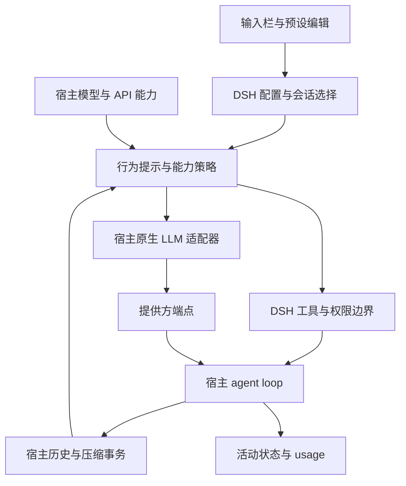

# Codex 行为适配：落地设计与验收

更新日期：2026-10-24。适用范围：RoyalLiang/dsh-codex-harness 0.2.24。本文记录设计约束与验收门槛；源码存在、单元测试、宿主加载、真实提供方请求是不同证据，不能互相替代。版本发布不代表已部署到实际使用 Profile 或已完成全部验收。

## 目标与成功条件

目标是将 DSH 默认 agent 的行为、推理控制、Fast 与上下文管理优化为 Codex 工作方式。当前包仍通过预设挂载能力，不会自动替换宿主默认 agent；选用 Codex 预设后，在 DSH 原生 agent loop 上执行一致的编码流程：理解任务和当前仓库，必要时规划，通过工具执行，检查结果，持续汇报，最终报告结果与未验证边界。具备基本工具调用能力的模型都可以使用这一行为协议；模型原生推理能力、输出质量和提供方服务等级取决于实际能力。

“参照 Codex 思考链路”指任务拆解、上下文选择、行动与验证闭环，以及原生 reasoning 参数与状态适配。不要求模型公开内部逐字思考，不把更长推理文字当作更强推理，不承诺复现其他产品未公开的内部实现。

完成标准：

- Codex 预设、按需工具和模型控制在当前 DSH 中实际生效。
- `default / low / medium / high / xhigh / max` 有明确继承、映射或降级语义；界面保存成功不等于提供方支持。
- Fast 与思考强度分别控制，不因 Fast 静默降低档位。
- 历史、工具调用配对、加密 reasoning 与签名等协议状态不被无依据裁剪。
- 缓存优化保留提示词语义和稳定历史；成本结论来自真实 usage 与可重复任务记录。
- 扩展沿用 DSH 的预设、插件、配置、LLM、sandbox、Remote 和 compaction 服务，避免第二套 agent loop 或注册表。

## 公开实现对比

以下为 2026-10-24 获取的公开资料，在线 main 与文档会变化。这里只采纳公开结构和契约，不推断闭源内部行为，不以其他产品的宣传作为本项目效果证据。

| 项目 | 公开实现和功能 | 本项目采用的原则 | 不照搬的部分 |
| --- | --- | --- | --- |
| [OpenAI Codex 配置源码](https://github.com/openai/codex/blob/main/codex-rs/core/config.schema.json) | 配置区分 provider、wire API、可选远程压缩能力、工具暴露、agent 角色和推理设置 | 以协议和能力决定请求行为；行为提示、工具和提供方设置分层 | 不把某版本的内部配置逐项搬成 DSH 设置，不复制第二套运行时 |
| [OpenCode 模型](https://opencode.ai/docs/models/) / [插件](https://opencode.ai/docs/plugins/) | 模型选项可被 agent 覆盖；variants 随提供方和模型不同；插件有工具、会话与 compaction hook | 通用 UI 表达意图，原生适配层表达合法参数；能力进入实际调用路径 | 不以统一档位名称假定全部 API 接受相同字段；实验 hook 不作为稳定契约 |
| [pi README](https://github.com/badlogic/pi-mono/blob/main/packages/coding-agent/README.md) / [扩展契约](https://github.com/badlogic/pi-mono/blob/main/packages/coding-agent/docs/extensions.md) | 精简核心，扩展工具、命令、模型、UI；区分 context、system context、provider request 与 tool hooks；按需工具暴露 | 复用宿主扩展点；明确数据归属再选 hook；展示状态与模型上下文分开 | 不在只接受调用配置的 hook 中修改冻结消息；不每轮改写整个 system prefix |
| [Claude Code 工作机制](https://code.claude.com/docs/en/how-claude-code-works.md) / [Fast](https://code.claude.com/docs/en/fast-mode.md) / [缓存设计](https://code.claude.com/docs/en/prompt-caching.md) | 收集上下文、行动、验证的循环；skills、MCP、hooks、subagents 分工；Fast 和 effort 独立并受能力和账户限制；稳定前缀复用，压缩摘要另有成本 | 行为闭环与结果验证；扩展按需加载；Fast 与预算分别验收；取消可恢复；运行时指导追加到会话 | 不承诺所有模型同等质量，不把优先服务必然等同于更快，不照搬计费与可用性 |

本项目最有效的优化是缩短“用户选择 → 宿主原生选项 → 实际请求 → 可观察结果”的链路，并保持历史和缓存稳定；抽象层数量不代表架构质量。

## 最小完整架构

插件拥有 Codex 操作提示、工具接口适配、预设能力开关、有限的 Responses 扩展及 UI。DSH 拥有历史、运行循环、权限、进程、持久化与提供方路由。插件不接管凭据或重建宿主消息结构。

领域边界使用现有模块：模型 gateway 解析能力，reasoning 策略定义设置语义，context 策略维护提示顺序，tooling 维护补丁约束。入口只装配真实生命周期；不为 DDD 增加多余 repository、service 或 factory。历史导出可兼容保留，但不因此保留有风险的执行路径。

### 模型能力与思考控制

1. 优先读取宿主解析后的 model/API 与 reasoning 能力。提供方和模型名只用于明确受限的兼容逻辑，不能证明 Lark、priority 或 `/responses/compact` 支持。
2. `default` 不强制 medium，保留已有请求或提供方设置。显式插件档位才覆盖当前请求，且只作用于 Codex 路径。
3. `max` 表示当前模型已知最高强度，不保证发送字符串 `max`。模型最高仅支持 high 时映射到 high；映射结果必须可检验。
4. 原生参数通过宿主支持的 reasoning 选项传递。不能只在对象上附加未经适配器验证的 `thinking`、`max_thinking_tokens` 就声称接通；无法证明支持时省略不合法字段。
5. 无原生档位的模型可接收简短工作深度指导。这是行为引导，不是 token 预算，不保证“五档质量等价”，不要求公开内部思考。
6. Fast 仅在当前协议和端点支持时请求相应服务等级。不支持时保留工作流程并说明边界，不能静默降 effort 或换模型。

原生能力优先不等于全模型已联调。OpenAI Responses、兼容网关、Anthropic、DeepSeek 和本地模型需分别验证；同一模型名也可能经不同 API 提供。

### 低 token 与缓存

- 稳定保留 persona、行为规则、工具和固定预设的相对顺序。不能覆盖 persona-first 语义，也不能挪动未知第三方区段改变优先级。
- 保持已有请求前缀稳定。用户显式修改预设、工具集或档位时允许必要变化，这类变化不能误报为未知缓存失败。
- cwd、Web 地址可能在同一会话中稳定；不能仅凭区段名称判为每轮动态，应比较实际序列化请求。
- 不在 `agent/request` 等调用配置事件中删除历史 reasoning。原生 block、签名、加密状态与 tool call/result 配对交由宿主和适配器维护。
- 优先减少重复读取和冗长工具结果；大结果用有界摘要与可重读引用，保留错误、路径、变更和未完成任务。压缩沿用宿主事务，成功后才替换历史；取消不发布成功摘要，不进入错误回退。
- 复用宿主按需 skills/工具发现。插件提示排序不等于已实现另一套工具懒加载。
- 不自行发送缓存保活，不靠丢失有效信息换低输入，不承诺“100%缓存命中”。

成本至少区分输入、输出、cache read/write、可用时的 reasoning tokens 与摘要调用。按提供方实际字段解释 usage，避免把含缓存总输入和未缓存输入混淆。缓存指标缺失时记未知，不记作零。

### 工具与 UI

补丁按精确或受控空白匹配；重复上下文、数值或标识符漂移必须失败并重新读取，不能按编辑距离覆盖语义修改。保留权限、原子写入、失败回滚和错误报告。

菜单提供 Default 与五档，Fast 独立显示。保存串行、错误可见、只读不写；键盘可打开、切换、退出并恢复焦点。UI 状态代表用户意图，不能替代请求验证；能力提示说明不支持或映射边界。

## 此轮实施跟踪

下表依据已核对源码与主任务于 2026-10-24 同步的结果。实现完成、自动检查、静态宿主契约、真实运行与发布分别记录；当前尚无真实宿主安装、GUI、提供方/API 或性能验收结果。

| 历史审查问题 | 已落地处置 | 验证边界 |
| --- | --- | --- |
| 非原生模型切档断链 | 动态 context 接入简短内部验证指导，与原生参数分开 | 源码已完成；实际模型行为待验证 |
| DeepSeek/Claude 仅对象赋值 | 使用宿主 metadata → `reasoningEffort` 原生契约 | 类型检查已通过；真实适配器请求待验证 |
| 冻结调用配置错误裁剪历史 | 删除错误历史裁剪及相关配置写入路径 | 源码已完成；请求与压缩边界回归已通过 |
| Gateway 与执行脱节 | 宿主解析后的 API/模型能力进入请求策略 | 源码已完成；未知能力省略强制参数，真实端点待验证 |
| default 强制 medium | 选择 Default 时继承；max 映射合法档；unknown 省略 | 源码已完成；请求与压缩边界回归已通过 |
| 模糊补丁误覆盖 | 受控匹配，歧义与语义漂移拒绝 | 18 项补丁测试已通过；真实宿主操作待验收 |
| 缓存排序覆盖 persona | 顺序策略返回宿主原始 assembly，保留 persona 与未知区段 | 源码已完成；真实请求 prefix 与缓存指标待验证 |
| 菜单缺 Default/交互约束 | Default、串行保存、可见错误、键盘及只读状态 | 实现已完成；UI 自动回归已通过，真实 UI 待验收 |

预设编辑器继续复用 registry 和宿主安全写入，保留内置只读、副本、revision、锁、备份和原子替换。既有远程压缩取消修复与诊断限额属于历史功能，不表示此轮再次验收。

## 验收矩阵

每项记录环境、源码提交、操作、预期、实际、证据位置和执行人。缺结果统一写“待验证”。单元测试不能代替端到端项目。

| 编号 | 操作或检查 | 通过条件 | 当前状态 |
| --- | --- | --- | --- |
| A01 | `pnpm check`、`pnpm test`、`pnpm build` | 同一源码全部成功，失败/跳过/环境限制分开记录 | 类型检查与构建已通过；完整 Vitest 19 个文件、208 项全部通过 |
| A02 | 实际 DSH ASAR 宿主兼容检查 | 静态模块契约符合，且 ConfigForms、Typert、registry、LLM 与插件启动可加载；真实 SystemPrompt 保留 persona、装配 Codex 提示与 Default 动态指导 | 44 个模块已静态核对；本轮当前源码在 2.0.19-next 真实宿主模块上的隔离集成已重跑通过，退出码 0 |
| A03 | 隔离 Profile 安装构建并重启 | 包来源与构建对应提交，插件启用且无启动错误 | 待验证 |
| A04 | 编辑预设、建副本、保存过期版本 | 用户配置保留、内置只读、旧 revision 不覆盖修改 | 待验证 |
| R01 | 原生模型逐档请求 | Default 继承、支持档传递、max 合法、无未知字段 | 待验证 |
| R02 | Anthropic / DeepSeek /兼容网关请求 | 适配器使用合法原生选项，不能只看对象赋值 | 待验证 |
| R03 | 无原生能力模型 Low/Max | 实际提示含深度指导，无非法字段，不宣称原生预算 | 待验证 |
| R04 | Fast 与 High 同用 | 支持时优先等级到请求且 effort 不变；不支持时无非法字段 | 待验证 |
| R05 | 非 Codex、后台模型、压缩请求 | 控制不泄漏，取消与重试保留宿主约定 | 待验证 |
| C01 | 同模型预设连续多轮比较脱敏请求 | 静态 prefix/工具顺序稳定，persona 不变，差异可解释 | 待验证 |
| C02 | reasoning/签名/工具调用续轮 | 冻结对象不修改，原生状态和调用配对完整 | 待验证 |
| C03 | 压缩成功、HTTP 失败、流中取消 | 仅成功提交；失败保留历史；取消不作为回退错误 | 待验证 |
| C04 | 收集真实 usage | 区分输入/缓存/输出/摘要，未知不冒充零 | 待验证 |
| T01 | 精确/空白补丁、重复上下文、数值漂移 | 合法可应用；歧义和漂移拒绝且文件不变 | 18 项补丁测试已通过；真实宿主操作待验收 |
| U01 | Default/五档/Fast 保存 | 刷新后正确、点击不乱序、错误可见、只读不写 | UI 自动回归及隔离 Chromium 交互/布局通过；实际 Profile GUI 待验收 |
| U02 | 键盘、窄屏、失焦与卸载 | 名称可访问，Escape 与焦点恢复，布局及事件清理正确 | UI 自动回归及隔离 Chromium 交互/布局通过；实际 Profile GUI 待验收 |
| B01 | 修 bug、多文件任务、长会话、中途纠正 | 调查后改动，有验证与汇报；压缩后目标约束不丢失 | 待验证 |

0.2.24 自动检查已重跑通过：`pnpm test` 共 19 个测试文件、208 项全部通过；`pnpm run check`、`pnpm run build` 与 `git diff --check` 通过。新增真实宿主模块场景覆盖旧 Persona `{{cwd}}`、后缀仅装配一次、Fast 与 High 同用、Default 继承。编译后的 `lib/client.js` 在 Chromium 中通过六档标签、Fast 与 High 独立保存、重挂载后读取、保存失败重试、Escape 焦点恢复、只读、模型显示位置以及 1100px/390px 布局断言；宿主属性和设置接口使用隔离 fixture。自动导航与截图受本机环境限制，浏览器场景通过 CDP 加载产物并验证 DOM；没有实际使用 Profile 的完整 GUI、真实提供方或性能验收结果。

实际 ASAR 的 44 个模块完成静态核对后，本轮已使用当前源码在 `dsh-desktop-next@2.0.19-next`（Electron 44.0.0 / Node 24.18.1）重跑 `scripts/verify-host-compat.mjs`，退出码 0，输出 `PASS: actual host loader`。真实服务范围为 loader、registry、LLM、gateway、SettingsForms 与 SystemPrompt；Codex 四个核心工具注册、persona 保留、Codex 提示装配与 Default 动态指导断言均通过。配置编辑器、工具执行器、会话和非目标依赖仍为隔离 fixture；没有调用提供方或改动已有 Profile。原始日志见工作区 `.audit/host-compat.stdout.log` 和 `.audit/host-compat.stderr.log`。

复现时设置 `ELECTRON_RUN_AS_NODE=1`、`DSH_HOST_ASAR` 指向目标桌面安装的 `app.asar`，再用该桌面可执行文件运行 `scripts/verify-host-compat.mjs`。Windows GUI EXE 的控制台输出可能需要重定向并等待进程退出。该检查验证真实宿主模块集成，不等同于桌面 Profile 安装、GUI 交互、完整进程重启或模型请求验收。

真实联调任务覆盖：带回归的小 bug；跨文件接口变更；连续工具调用直到压缩；补丁前文件发生语义漂移；运行中取消模型或摘要；切模型续会话。核对最终工作区与实际模型请求，菜单截图不足以完成验收。

## 性能与六维评审

固定任务集、模型/版本/端点、初始仓库与努力档，比较基线和候选；冷请求、连续暖请求、长间隔分开统计。报告样本量、中位耗时和分布，包含失败与重试。提供方 TTL 和路由可能变化，插件可验证前缀稳定，不能控制命中。

| 维度 | 核心问题 | 最小证据 |
| --- | --- | --- |
| 架构与扩展 | 新模型复用能力吗？是否单一装配路径？ | 能力到 transport 调用链与新模型用例 |
| 推理与正确性 | 档位生效、Default 继承、压缩后续任务吗？ | 原生适配器请求与行为记录 |
| token 与延迟 | 是否包含错误、摘要、重试成本？ | 完整 usage、任务结果、延迟分布 |
| 交互与可访问性 | 用户选择和实际执行是否一致？ | UI、保存失败、键盘、只读记录 |
| 可靠性与数据 | 取消、歧义、历史、配置冲突是否保数据？ | 故障后的文件/历史/配置对比 |
| 兼容与交付 | 当前宿主能运行此源码对应构建吗？ | 版本、提交、构建和隔离安装记录 |

不写未测量的“节省 60% tokens”“85%缓存命中”。无对照只描述结构优化与假设；正确性下降不能因 tokens 少就判成功。

## 交付与发布

1. 收敛源码和回归检查，更新实施状态并保留未验证项。
2. 目标 DSH 做加载与隔离 Profile 联调，核对请求、恢复与 UI。
3. 固定任务集记录成本和结果，达到正确性门槛后才报告收益。
4. 按[维护说明](maintenance.md)生成同一提交对应构建与新标签。现有 `v0.2.23` 不自动获得工作区改动，不覆盖已发布标签。
5. 备份用户配置后升级实际 Profile，刷新或重启目标 GUI，核对版本后再记部署完成。

[本地优化记录](local-optimization.zh.md)的测试数与构建结果只属于当时版本，不作为本次验收证据。源码文件存在不等于上线或真实模型验证。
